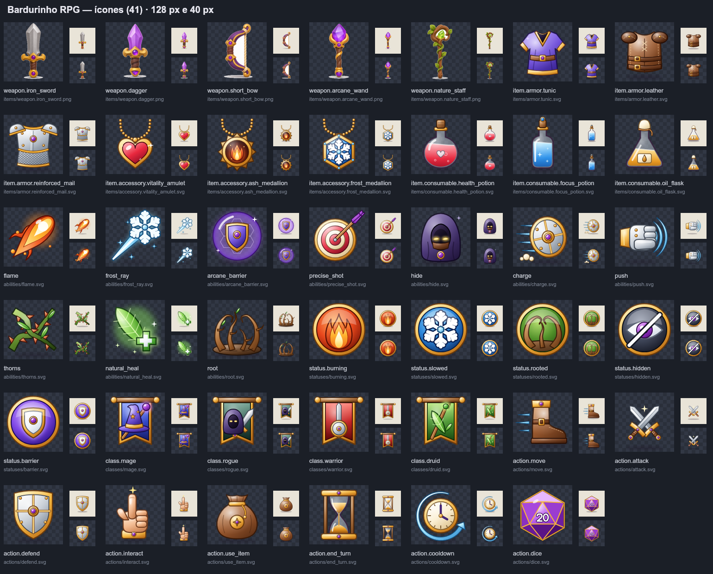

# Ícones (Fase 4 — seção 7.3 do plano)

Conjunto de 41 ícones 256 × 256 com fundo transparente: as 5 armas em PNG (arte-mestre,
`assets/icons/items/master/`) e 36 ícones vetoriais (SVG) gerados por código.



## Ids e arquivos

Todos os caminhos ficam em `packages/assets-manifest/src/index.ts` (`icons`), relativos a `assets/`.

| Categoria | Ids | Pasta |
|---|---|---|
| Habilidades (10) | `icon.flame`, `icon.frost_ray`, `icon.arcane_barrier`, `icon.precise_shot`, `icon.hide`, `icon.charge`, `icon.push`, `icon.thorns`, `icon.natural_heal`, `icon.root` (= `presentation.iconId` do conteúdo) | `icons/abilities/<nome>.svg` |
| Itens (14) | `icon.weapon.*` (PNG) e `icon.item.<itemId>` para armaduras, acessórios e consumíveis | `icons/items/<itemId>.{png,svg}` |
| Estados (5) | `icon.status.burning`, `.slowed`, `.rooted`, `.hidden`, `.barrier` | `icons/statuses/<id>.svg` |
| Classes (4) | `icon.class.mage`, `.rogue`, `.warrior`, `.druid` | `icons/classes/<id>.svg` |
| Ações (8) | `icon.action.move`, `.attack`, `.defend`, `.interact`, `.use_item`, `.end_turn`, `.cooldown`, `.dice` | `icons/actions/<id>.svg` |

Funções auxiliares (todas devolvem o caminho relativo a `assets/` ou `undefined`):
`iconPath(iconId)`, `itemIconPath(itemId)`, `abilityIconPath('mage.flame')`,
`statusIconPath('burning')`, `classIconPath('mage')`, `actionIconPath('end_turn')`.
Para a URL: `assetUrl(abilityIconPath('mage.flame')!)` → `/icons/abilities/flame.svg`.

## Como regenerar

```sh
npm run icons:svg     # escreve os 36 SVGs (determinístico: mesma saída a cada execução)
npm run icons:sheet   # folha de contato em docs/screenshots/fase-04/ (128 px, 40 px e zoom de 32 px)
npm run icons         # (já existente) reduz as imagens-mestre PNG para 256 × 256
```

Os desenhos estão em `tools/icons/svg.ts`, um por função, agrupados por categoria.
Os SVGs são artefatos gerados: edite o gerador, não os arquivos.

## Decisões de estilo

- **Mesmo acabamento das armas**: "cartoon 3D" brilhante — gradiente linear claro → escuro
  (cima-esquerda para baixo-direita), contorno fino na cor escura do próprio material,
  reflexo radial branco por cima de cada peça e sombra suave desfocada no chão.
- **Paleta compartilhada** (`M` no gerador): ouro para acabamentos, gemas roxas,
  aço, couro, madeira; cores por elemento — fogo laranja, gelo/arcano azul-ciano e
  roxo, natureza verde.
- **Silhueta por categoria**, para que o tipo seja reconhecível antes do desenho:
  habilidades e itens são objetos soltos; **estados** são medalhas redondas (disco colorido
  com aro dourado + glifo claro), legíveis a 24–32 px como emblemas sobre as unidades;
  **classes** são estandartes pendurados, na cor da classe; **ações** são objetos soltos.
- **Legibilidade em 32–48 px**: uma forma principal grande, poucos detalhes finos, glifos
  claros sobre fundos escuros nos estados. Conferido no zoom de 32 px
  (`screenshots/fase-04/icones-32px-zoom.png`).
- Ids de `<defs>` (gradientes, filtros, recortes) são prefixados pelo nome do ícone, então os
  SVGs podem ser embutidos lado a lado no mesmo documento HTML sem colisão.

## Pendências

- As imagens-mestre das 5 armas têm fundo branco opaco. Resolvido na versão web: `npm run icons`
  (`tools/icons/resize.ts`) agora remove o fundo branco ligado às bordas (com borda suave) ao
  gerar os PNGs 256 × 256; as mestres continuam intactas. Recortar as mestres ainda seria melhor
  (a sombra clara sob a arma fica levemente esbranquiçada).
- A seção 7.3 também prevê 8 ícones de **recursos** (HP, PA, PM, Foco...), ainda não feitos.
